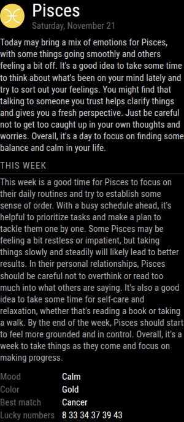
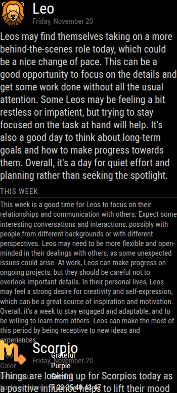
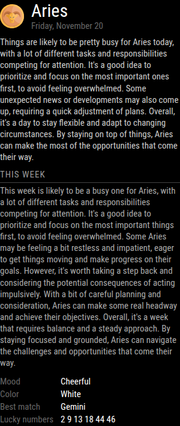
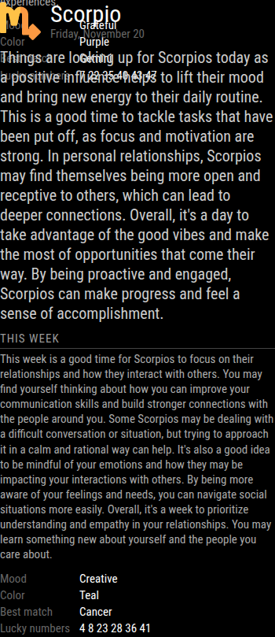

# MMM-Astro

A [MagicMirror²](https://github.com/MagicMirrorOrg/MagicMirror) module that shows **today's horoscope**
for your star sign, plus **this week's** horoscope and a lucky mood, color, best match and numbers
for the day.

## Screenshots

Four icon sets to choose from:

| `iconset: "1"` | `iconset: "2"` |
|:---:|:---:|
|  |  |

| `iconset: "3"` | `iconset: "4"` |
|:---:|:---:|
|  |  |

---

## Requirements

- MagicMirror² 2.3x (Node 18 or newer)
- An internet connection. The horoscopes come from [freehoroscopeapi.com](https://freehoroscopeapi.com),
  which is free and needs **no API key**.

## Install

```bash
cd ~/MagicMirror/modules
git clone https://github.com/cowboysdude/MMM-Astro
```

**Do I need to run `npm install`?** No. The module has no dependencies.

## Add it to your config

In `~/MagicMirror/config/config.js`, inside `modules: [ ... ]`:

```js
{
  module: "MMM-Astro",
  position: "top_right",
  config: {
    sign: "pisces",
    iconset: "1",
    extend: true
  }
},
```

Restart MagicMirror to see it.

## Options

| Option | Default | What it does |
|---|---|---|
| `sign` | none (**required**) | Your star sign: `aries`, `taurus`, `gemini`, `cancer`, `leo`, `virgo`, `libra`, `scorpio`, `sagittarius`, `capricorn`, `aquarius` or `pisces`. |
| `iconset` | `"1"` | Which icon set to use: `"1"`, `"2"`, `"3"` or `"4"` (see the screenshots). |
| `extend` | `true` | Also show this week's horoscope. Set to `false` for today only. |
| `showLucky` | `true` | Show the lucky mood, color, best match and numbers. Set to `false` to hide them. |
| `maxWidth` | `"300px"` | How wide the module can get. |
| `updateInterval` | `3600000` (1 hour) | How often to check for a new day's horoscope, in milliseconds. |

Want horoscopes for two people? Add the module twice, each with its own `sign`.

## Good to know

- The horoscope text changes once a day. The module fetches it once and keeps it until the next day.
- Mood, color, best match and lucky numbers are just for fun. They are picked fresh each day for your
  sign and stay the same all day. "Best match" comes from the signs traditionally said to get along
  with yours.
- If the horoscope site can't be reached, the module says so and tries again every 5 minutes.

## Troubleshooting

| What you see | What to do |
|---|---|
| `set "sign" in config.js` | Add `sign: "pisces"` (or your sign) to the module's `config`. |
| "Horoscope not available right now" | Check the mirror's internet connection. It will keep trying on its own. |
| No icon | Make sure `iconset` is `"1"`, `"2"`, `"3"` or `"4"`. |

## What changed in v2

- Works again. The old horoscope services (horoscope-api.herokuapp.com and aztro) shut down, so it
  now uses freehoroscopeapi.com.
- New: this week's horoscope, shown with `extend: true`.
- No more `npm install`, and no dependencies at all. The random.org API key is gone too.
- Cleaner layout, and each module instance can have its own sign.

## Credits

Created by **cowboysdude** (formerly MMM-Astrology). Horoscopes from
[freehoroscopeapi.com](https://freehoroscopeapi.com), for entertainment only. MIT License.
